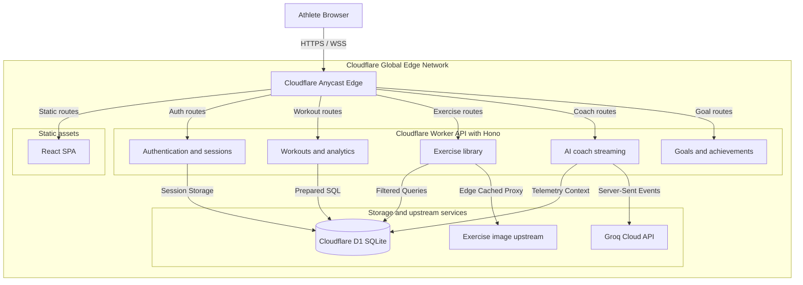

# RepForge — Production Cloudflare Architecture & Deployment Guide

> **Status:** Production Deployed on Cloudflare Pages & Cloudflare D1  
> **Production Live URL (Clean Domain):** [`https://repforge-app.pages.dev`](https://repforge-app.pages.dev)  
> **Edge Database:** Cloudflare D1 `repforge-db` (`a70eb32e-c5e0-46c6-bf38-b8223047dd25`)  
> **Worker Fallback:** [`https://repforge.chetanaybatra03-8b2.workers.dev`](https://repforge.chetanaybatra03-8b2.workers.dev)  

---

## 1. Architectural Strategy & Platform Decision

### The Decision: 100% Cloudflare Native Architecture
RepForge has migrated completely away from legacy monolithic containers (such as Render) to a **100% Cloudflare-native full-stack edge platform**.

| Dimension | Legacy Container (Render / Fly) | Cloudflare Edge Platform (RepForge Current) |
|---|---|---|
| **Cold Start Latency** | 30s to 60s (container boot & sleep) | **7ms - 9ms** (V8 Isolate Edge Execution) |
| **Edge Proximity** | Single origin region (e.g., Oregon) | **300+ Edge Data Centers globally** |
| **Origin / CORS Complexity** | Cross-origin `SameSite=None` cookies required | **Unified Single-Origin:** Frontend & API live on the exact same domain |
| **Database Latency** | High TCP handshake overhead | **Cloudflare D1:** Serverless SQLite at the edge, sub-millisecond query execution |
| **Static Asset Delivery** | Proxied through container or CDN layer | **Cloudflare Workers Static Assets:** Zero-copy global caching |
| **Operational Overhead** | Dockerfiles, WSGI workers, reverse proxies | Declarative `wrangler.toml` and CLI deployments |

---

## 2. Platform Architecture



---

## 3. Cloudflare D1 Database Schema

Cloudflare D1 provides distributed, serverless SQL storage backed by SQLite at the Cloudflare edge.

- **Database Name:** `repforge-db`
- **Database ID:** `a70eb32e-c5e0-46c6-bf38-b8223047dd25`
- **Region:** APAC (Primary HKG)

### Tables Implemented
1. `users` — Athlete identity records (Google sub, email, name, avatar).
2. `workout_days` — Calendar training days, day numbers, and custom session labels.
3. `workout_exercises` — Movements logged per training session with split classifications.
4. `workout_sets` — Individual sets with bounded reps (1–500) and weights (0–1000 kg).
5. `sessions` — Server-side revocable session store tied to `repforge_session` cookies.
6. `oauth_states` — Atomic single-use state/nonce records preventing OAuth replay attacks.
7. `goals` — Athlete training targets (volume, weekly frequency, PR thresholds).
8. `exercises` — 876 complete exercise taxonomy from the open-source `free-exercise-db`.
9. `user_favorite_exercises` — Fast many-to-many relationship for athlete favorites.

---

## 4. Security & Cookie Specifications

### Single-Origin Advantage
Because the frontend single page app and the API backend run together on `https://repforge.chetanaybatra03-8b2.workers.dev`:
- **CORS:** Cross-origin restrictions are completely eliminated for first-party browser navigation.
- **Session Cookie:**
  - `Name:` `repforge_session`
  - `HttpOnly:` `true` (unreadable via JavaScript/XSS).
  - `Secure:` `true` (transmitted exclusively over TLS).
  - `SameSite:` `Lax` (safely attached to top-level navigation while blocking cross-site injection).
  - `Path:` `/`
- **CSRF Defense:** Double-submit token architecture with memory-only frontend storage.
- **Groq Prompt Guardrails:**
  - Invariant medical refusal filter.
  - Dangerous prompt tags (`[INST]`, `system:`, HTML tags) stripped before sending to Groq.
  - Strict grounding prompt binding GPT-OSS-120B responses to verified telemetry from D1.

---

## 5. Deployment Commands

### Prerequisites
- Node.js 20+
- Wrangler CLI (`npm install -g wrangler` or via `npx wrangler`)
- Cloudflare Account with D1 & Workers permissions

### Build & Deploy Steps
```bash
# 1. Install dependencies
npm install

# 2. Build the production React + Three.js 3D bundle
npm run build

# 3. Deploy full-stack to Cloudflare Pages (Clean pages.dev domain)
npm run deploy
```

### Setting Environment Secrets
To configure production Google OAuth and Groq API keys on Cloudflare:
```bash
# Set Groq Cloud API Key
npx wrangler secret put GROQ_API_KEY

# Set Google OAuth Credentials
npx wrangler secret put GOOGLE_CLIENT_ID
npx wrangler secret put GOOGLE_CLIENT_SECRET
```

### Local Development
```bash
# Run local Vite development server with proxy (Frontend on port 5173)
npm run dev

# Run local Cloudflare Worker simulation with D1 local storage
npx wrangler dev
```

---

## 6. Google Cloud Console Configuration Guide

To enable Google OAuth authentication in RepForge, configure your credentials in the [Google Cloud Console](https://console.cloud.google.com/):

### Step 1: Create OAuth 2.0 Client ID
1. Navigate to **APIs & Services** > **Credentials**.
2. Click **Create Credentials** > **OAuth client ID**.
3. Choose **Application type**: `Web application`.
4. Set **Name**: `RepForge Web Client`.

### Step 2: Authorized JavaScript Origins
Add the following origins (no trailing slashes):
- `https://repforge-app.pages.dev` *(Production Clean Domain)*
- `https://repforge.chetanaybatra03-8b2.workers.dev` *(Cloudflare Workers Domain)*
- `http://localhost:5173` *(Local Vite Frontend)*
- `http://localhost:8787` *(Local Wrangler Dev)*
- `http://localhost:5000` *(Local Flask Backend)*

### Step 3: Authorized Redirect URIs
Add the exact callback URLs:
- `https://repforge-app.pages.dev/auth/google/callback` *(Production Clean Domain)*
- `https://repforge.chetanaybatra03-8b2.workers.dev/auth/google/callback` *(Cloudflare Workers Domain)*
- `http://localhost:5173/auth/google/callback` *(Local Vite Frontend)*
- `http://localhost:8787/auth/google/callback` *(Local Wrangler Dev)*
- `http://localhost:5000/auth/google/callback` *(Local Flask Backend)*

### Step 4: OAuth Consent Screen Setup
1. Go to **APIs & Services** > **OAuth consent screen**.
2. **User type**: `External`.
3. **App name**: `RepForge`.
4. **User support email**: Your email (e.g. `chetanaybatra03@gmail.com`).
5. **Scopes**: Add `openid`, `.../auth/userinfo.email`, and `.../auth/userinfo.profile`.
6. **Test users**: While in testing mode, add your email address under **Test users**.

### Step 5: Save & Apply Secrets
Copy the **Client ID** and **Client Secret** and run:
```bash
npx wrangler secret put GOOGLE_CLIENT_ID
npx wrangler secret put GOOGLE_CLIENT_SECRET
```
And add them to `backend/.env` for local Flask development.
