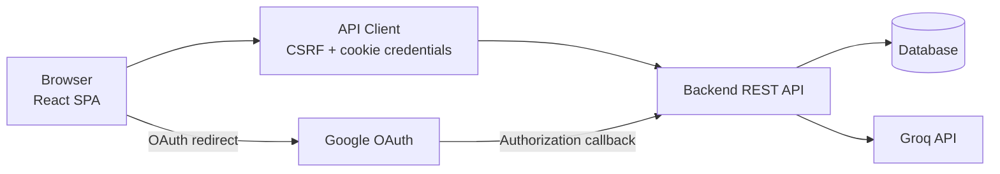
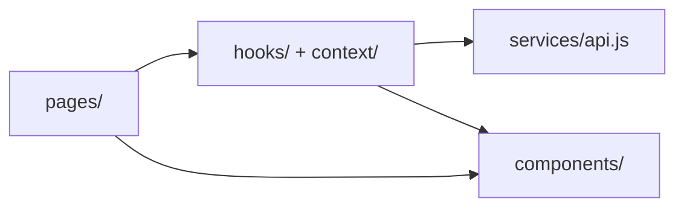

<div align="center">

# RepForge

**A mobile-first workout tracker with an AI strength coach.**

Log every set, see your progress, and ask a coach that knows your training history.

[](https://github.com/chetanaybuilder/RepForge/actions/workflows/ci.yml)
[](LICENSE)
[](https://react.dev/)
[](https://vite.dev/)
[](https://nodejs.org/)
[](https://pages.cloudflare.com/)
[](#contributing)

[**Live Demo**]({{LIVE_DEMO_URL}}) · [Backend](backend/) · [Report a Bug](https://github.com/chetanaybuilder/RepForge/issues/new)

<br />


<br />

**876** exercises &nbsp;·&nbsp; **6** core sections &nbsp;·&nbsp; **Streaming** AI coach &nbsp;·&nbsp; **Mobile + desktop** layouts

</div>

---

## Table of contents

- [Why this project](#why-this-project)
- [How it works](#how-it-works)
- [Features](#features)
- [Screenshots](#screenshots)
- [Tech stack](#tech-stack)
- [Architecture](#architecture)
- [Getting started](#getting-started)
- [Scripts](#scripts)
- [Project structure](#project-structure)
- [Engineering notes](#engineering-notes)
- [Roadmap and known limitations](#roadmap-and-known-limitations)
- [Contributing](#contributing)
- [License](#license)
- [Author](#author)

---

## Why this project

Logging a workout on a phone has to be fast enough to keep your focus between sets. The history you build should also answer useful questions afterwards: am I getting stronger, which lifts have stalled, and what should I do next session?

RepForge puts session logging, an exercise library, progress analytics, goals, and an AI coach in one app. It is designed for small and large screens, and it degrades gracefully on low-power devices instead of breaking.

---

## How it works

1. **Log**: record exercises, sets, weight, and reps. A built-in rest timer keeps you on pace.
2. **Learn**: the dashboard and progress views turn your sets into volume trends, streaks, and personal records.
3. **Level up**: ask the coach about your training, or run diagnostics on a finished session to get the next step.

---

## Features

| Feature | Benefit |
| --- | --- |
| Set-by-set workout logging | Record exercises, weight, reps, and multiple working sets in one session. |
| Rest timer | Start and manage rest periods without leaving the workout flow. |
| Session editing and deletion | Update or remove logged workouts after the fact. |
| 876-movement exercise library | Search by name and filter by muscle group and equipment. |
| Favorites | Keep frequently used exercises one tap away. |
| Dashboard metrics | See total training volume, streaks, and recent sessions at a glance. |
| Progress analytics | Compare volume over time, per-exercise progression, and movement distribution. |
| Personal records | Surface milestones on the dashboard and analysis views. |
| Goals and achievements | Set targets and track unlocked achievements. |
| Streaming AI coach | Ask training questions and watch answers stream in through a secure backend. |
| Session diagnostics | Generate a coach review of any logged session. |
| Google sign-in | Server-managed OAuth with cookie-based sessions. |
| Mobile bottom-sheet workflows | Touch-friendly modals for logging and editing. |
| Adaptive graphics | Lightweight or WebGL visuals based on device capability and reduced-motion settings. |

---

## Screenshots

Product proof from the running RepForge app:

<table>
  <tr>
    <td align="center" width="50%">
      
      <br /><sub><strong>Dashboard</strong><br />Training volume, current streak, and volume progression at a glance.</sub>
    </td>
    <td align="center" width="50%">
      
      <br /><sub><strong>Workout log</strong><br />Sessions grouped by day with per-set detail, edit, delete, and coach diagnostics.</sub>
    </td>
  </tr>
  <tr>
    <td align="center" width="50%">
      
      <br /><sub><strong>AI coach</strong><br />Streaming replies with formatted lists and copy-to-clipboard.</sub>
    </td>
    <td align="center" width="50%">
      
      <br /><sub><strong>Exercise library</strong><br />876 movements with search, muscle and equipment filters, and favorites.</sub>
    </td>
  </tr>
  <tr>
    <td align="center" width="50%">
      
      <br /><sub><strong>Progress</strong><br />Progression curves and movement distribution.</sub>
    </td>
    <td align="center" width="50%"></td>
  </tr>
</table>

---

## Tech stack

| Area | Technology | Why it is used |
| --- | --- | --- |
| Frontend | React 18 | Component-based UI with hooks for state and lifecycle behavior. |
| Frontend | Vite | Fast local development and optimized production bundles. |
| Frontend | React Router | Route-level navigation and protected pages. |
| Frontend | Framer Motion | Interface transitions with reduced-motion handling. |
| Frontend | Recharts | Volume, progression, and distribution charts. |
| Frontend | Three.js / React Three Fiber | Optional 3D visuals, lazy-loaded with fallbacks. |
| Backend | Flask API (`backend/`), Cloudflare Worker + D1 (`worker/`, `migrations/`) | REST API, sessions, and data storage. |
| Tooling | ESLint, Prettier | Static checks and consistent formatting. |
| Tooling | GitHub Actions | Automated lint, format, backend, and build checks. |
| Integrations | Google OAuth | Server-handled sign-in redirect and identity exchange. |
| Integrations | Groq-powered coach | Streaming coaching responses delivered through the backend. |
| Dataset | free-exercise-db | Exercise movements and metadata. |

---

## Architecture





**Key design decisions**

- **CSRF in memory only.** The token is never written to `localStorage`, which limits exposure if an XSS bug ever appears. Mutating requests carry it as a header.
- **HttpOnly cookie sessions.** The frontend never sees or stores the session token.
- **Security headers.** `public/_headers` ships a strict Content-Security-Policy, `X-Frame-Options: DENY`, `nosniff`, `Cross-Origin-Opener-Policy`, and a restrictive `Permissions-Policy`.
- **Bounded caches.** Shared data caches have a maximum size and a TTL, which prevents stale data and unbounded memory growth.
- **Lazy, adaptive 3D.** Three.js loads only on capable devices and falls back to CSS or 2D for low-tier hardware and reduced-motion users.
- **Streamed coach replies.** Responses arrive as Server-Sent Events and update the chat incrementally.
- **Safe modals.** Portal-based modals share a ref-counted scroll lock so stacked dialogs restore the page correctly.
- **Local calendar dates.** Workout dates are handled as local `YYYY-MM-DD` values to avoid timezone day-shift bugs.

---

## Getting started

### Prerequisites

- Node.js `>=18.18.0` and npm
- A running RepForge backend, connected to its database
- Google OAuth and Groq credentials, only when testing those integrations

### Install and run

```bash
git clone https://github.com/chetanaybuilder/RepForge.git
cd RepForge
npm ci
cp frontend/.env.example frontend/.env
npm run dev
```

The Vite dev server proxies `/api` and `/auth` to the configured backend target.

### Build and preview

```bash
npm run build
npm run preview
```

The frontend build writes to `../dist` by default. Set `CF_PAGES_OUTPUT_DIR` to override the output directory. The backend runs separately; see the [`backend/`](backend/) directory.

### Environment variables

Create `frontend/.env` from the committed example file.

| Name | Required | Example | Purpose |
| --- | --- | --- | --- |
| `VITE_API_URL` | No for same-origin deployments | `http://localhost:5000` | Browser API origin for a separately hosted backend. |
| `VITE_DEV_PROXY_TARGET` | No locally if using the default | `http://localhost:5000` | Backend target for the Vite dev proxy. |

Server-only values such as `SESSION_SECRET`, `GOOGLE_CLIENT_SECRET`, and `GROQ_API_KEY` belong in the backend environment, never in frontend variables.

---

## Scripts

### Root scripts

| Script | Description |
| --- | --- |
| `npm run dev` | Starts the frontend Vite development server. |
| `npm run build` | Builds the frontend and packages the Cloudflare Worker. |
| `npm run build:worker` | Builds the Worker output from the worker source. |
| `npm run check:cloudflare` | Verifies the generated Cloudflare Pages artifact. |
| `npm run preview` | Starts the frontend preview server. |
| `npm run deploy` | Builds and deploys the Cloudflare Pages output. |
| `npm run lint` | Runs frontend ESLint checks. |
| `npm run format:check` | Checks formatting for repository configuration and scripts. |
| `npm run format` | Formats frontend files through the frontend package. |
| `npm run test:backend` | Runs the Python backend pytest suite. |

### Frontend scripts

| Script | Description |
| --- | --- |
| `npm run dev` | Starts Vite from the frontend workspace. |
| `npm run build` | Creates the frontend production bundle. |
| `npm run preview` | Serves the generated bundle locally. |
| `npm run lint` | Runs ESLint against `src`. |
| `npm run lint:fix` | Applies available ESLint fixes. |
| `npm run format` | Applies Prettier formatting. |
| `npm run format:check` | Verifies files match Prettier formatting. |
| `npm run check` | Runs lint and the production build. |

---

## Project structure

```text
RepForge/
├── backend/
│   ├── auth/                 # OAuth and request authentication
│   ├── database/             # Schemas, migrations, and exercise data
│   ├── routes/               # Flask API routes
│   ├── services/             # Backend integrations and business logic
│   └── tests/                # Backend pytest coverage
├── frontend/
│   ├── public/               # Headers, redirects, manifest, and icons
│   ├── src/
│   │   ├── components/       # Reusable UI and workout components
│   │   ├── components/3d/    # WebGL scenes and 2D fallbacks
│   │   ├── context/          # Auth, toast, and timer providers
│   │   ├── hooks/            # Data fetching and modal behavior
│   │   ├── pages/            # Route-level screens
│   │   ├── services/         # API client and session handling
│   │   ├── styles/           # Tokens and modular CSS
│   │   └── utils/            # Date, formatting, and graphics helpers
│   └── vite.config.js        # Dev proxy and production output
├── worker/
│   └── index.js              # Cloudflare Worker API implementation
├── scripts/
│   └── build-worker.mjs      # Worker build and packaging
├── migrations/               # D1 database migrations
├── docs/
│   ├── screenshots/          # README screenshots
│   └── media/                # Additional repository media
├── .github/workflows/        # Continuous integration
├── LICENSE                   # MIT license
└── package.json              # Workspace scripts and dependencies
```

<details>
<summary>Frontend source groups</summary>

```text
frontend/src/
├── App.jsx                   # Providers and protected route composition
├── main.jsx                  # React entry point
├── pages/                    # Dashboard, workouts, coach, progress, goals
├── components/               # Forms, modals, navigation, and charts
├── context/                  # Cross-screen application state
├── hooks/                    # Data request and UI lifecycle behavior
├── services/                 # CSRF and authenticated API transport
├── styles/                   # Theme, layout, forms, cards, and modals
└── utils/                    # Shared browser-safe helpers
```

</details>

---

## Engineering notes

**Mobile keyboard and bottom-sheet layout.** On Android, opening the keyboard shrinks the viewport and made the logging sheet cover half the screen. The editor is now a fixed-height sheet with a scrolling body and a pinned footer, no longer auto-focuses inputs, and keeps the rest timer clear of the action buttons.

**WebGL context limits.** Phones allow only a handful of WebGL contexts. 3D views use capability detection, lazy bundles, a cap on live 3D badges, and non-WebGL fallbacks, so low-tier devices never download graphics code they cannot run.

**Timezone-safe dates.** Workout dates travel as local calendar values rather than UTC timestamps, and a shared helper validates `YYYY-MM-DD` before building display dates. This avoids wrong-day logging in timezones ahead of UTC.

**Accurate rest timer.** The countdown is derived from an end timestamp instead of counting interval ticks, so it stays correct after the browser throttles a background tab. Pause and resume restart the clock from the remaining time.

**Stale response protection.** Data loaders track mounted state and request IDs, so a slow earlier response can never overwrite newer results.

---

## Roadmap and known limitations

- [ ] Add a service worker and explicit offline mode.
- [ ] Expand automated interaction, accessibility, and real-device visual regression coverage.
- [ ] Add internationalization and locale-aware number and date preferences.
- [ ] Add wearable and external fitness-platform imports.
- [ ] Add shareable progress views and export formats.
- [ ] Add Open Graph metadata and a social preview image.

---

## Contributing

Fork the repository, create a focused branch, and run `npm run lint` and `npm run build` before opening a pull request. Keep unrelated cleanups separate from behavior changes.

---

## License

RepForge is available under the [MIT License](LICENSE).

---

## Author

**{{chetanaybuilder}}**

{{future founder}}

[GitHub](https://github.com/chetanaybuilder) · [LinkedIn]({{LINKEDIN_URL}}) · [Live demo]({{LIVE_DEMO_URL}})

If RepForge is useful or interesting to you, feedback, issues, and stars are very welcome.