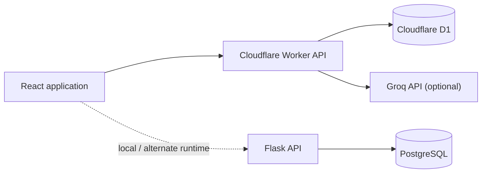

# RepForge

### A focused strength-training app for logging, reviewing, and progressing your training.

[](https://github.com/chetanaybuilder/RepForge/actions/workflows/ci.yml)
[](https://repforge-app.pages.dev)

RepForge brings workout logging, exercise discovery, progress tracking, goals, and an AI coaching experience into one responsive application. Its interface combines a fast React frontend with a Cloudflare Worker API and D1 persistence, with a Flask backend available for local and alternate deployments.

[Open RepForge](https://repforge-app.pages.dev) · [Deployment guide](DEPLOYMENT.md)

---

## What it does

- **Log training sessions** with exercises, sets, reps, weight, and completion state.
- **Browse the exercise library** with search and muscle-group filters.
- **Review training data** through dashboard summaries, progress charts, and personal-record tracking.
- **Set measurable goals** and monitor progress toward them.
- **Ask the AI coach** for training guidance, with streamed responses when the service is configured.
- **Use the app across devices**, including compact workout entry and an optional 3D dashboard experience.

## Built with

| Area              | Technologies                                            |
| ----------------- | ------------------------------------------------------- |
| Frontend          | React 18, Vite, React Router, Recharts, Three.js        |
| Edge API          | Cloudflare Workers, Hono                                |
| Edge persistence  | Cloudflare D1                                           |
| Alternate backend | Python, Flask, PostgreSQL                               |
| Tests and quality | Vitest, Testing Library, Pytest, Ruff, ESLint, Prettier |

## Engineering highlights

- Session-based authentication with OAuth state validation and CSRF protection for mutations.
- User-scoped workout and goal APIs backed by parameterized database queries.
- Lazy-loaded 3D visuals with a 2D fallback for devices without WebGL support.
- Separate frontend and backend test suites, with lint, formatting, and build checks in CI.

## Architecture



The deployed Pages application uses the Worker and D1 path. The Flask service is maintained as an alternate backend and is tested separately.

## Run locally

### Frontend with the Flask API

Prerequisites: Node.js 20+ and Python 3.11+.

1. Install frontend dependencies from the repository root:

   ```bash
   npm ci
   ```

2. Create and activate a Python environment, then install backend dependencies:

   ```powershell
   cd backend
   py -m venv .venv
   .venv\Scripts\Activate.ps1
   py -m pip install -r requirements.txt
   ```

   On macOS/Linux, activate with `source .venv/bin/activate`.

3. Copy the safe template and configure local values in `backend/.env`:

   ```powershell
   Copy-Item ..\.env.example .env
   ```

   On macOS/Linux, use `cp ../.env.example .env`. Supply your own database and provider credentials only when needed. Never commit `.env` files or paste credentials into issues or logs.

4. Start the Flask API from `backend`:

   ```bash
   python app.py
   ```

5. In another terminal, from the repository root, start the frontend:

   ```bash
   npm run dev
   ```

   Open `http://localhost:5173`. Vite proxies `/api` and `/auth` to the Flask service on port `5000`.

### Cloudflare Worker

Build the Pages application and Worker bundle:

```bash
npm ci
npm run build
npm run check:cloudflare
```

For local Worker development, configure private values in an ignored `.dev.vars` file and use Wrangler's local D1 database. For deployment, configure Worker secrets in the Cloudflare dashboard or with `wrangler secret put`; do not store production secrets in this repository.

After building, start the Pages/Worker development environment with:

```bash
npx wrangler pages dev dist
```

## Quality checks

Run the same core checks used by CI:

```bash
npm run lint
npm --prefix frontend run format:check
npm run test
npm run test:backend
python -m ruff check backend
python -m ruff format --check backend
npm run build
npm run check:cloudflare
```

The current suites cover the React API/components and Flask authentication, CSRF, workout, exercise, goal, and coach behavior.

## Repository layout

```text
backend/       Flask API, database access, services, and tests
frontend/      React application, styles, and component tests
migrations/    Cloudflare D1 migrations
scripts/       Worker build and Pages output verification
worker/        Cloudflare Worker API
docs/media/    Screenshots and product demo GIFs
```

## Security notes

- Keep `.env`, `.dev.vars`, local database files, and provider credentials out of Git.
- Use the committed `.env.example` files only as templates; replace placeholders locally.
- If a credential was ever committed or shared, rotate it at its provider. Removing it from the latest commit does not remove it from Git history.
- Report security concerns privately to the repository maintainer rather than including exploit details in a public issue.

## Credits

The exercise catalog is based on [free-exercise-db](https://github.com/yuhonas/free-exercise-db). Review its upstream license and attribution requirements when redistributing the dataset.

---

## Dashboard preview


