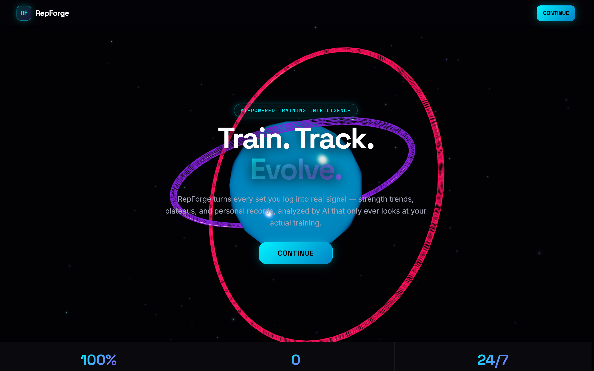
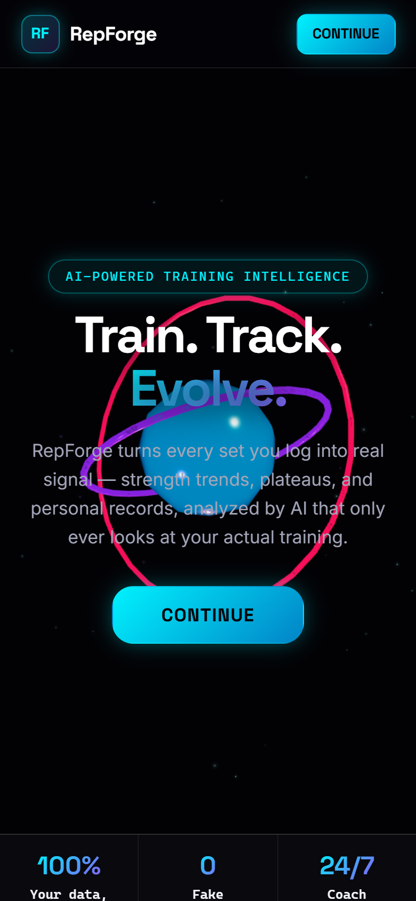
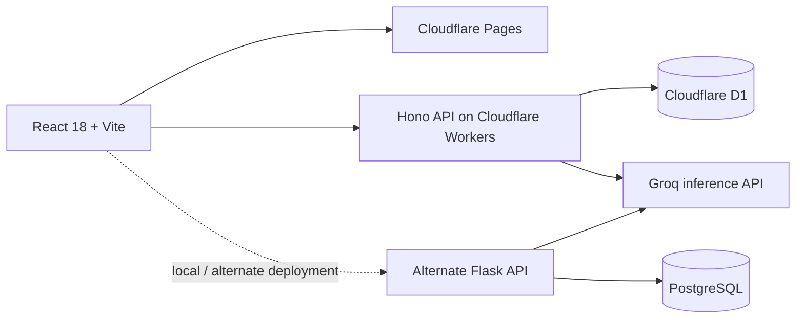

<div align="center">

# RepForge

### The AI-Powered Strength & Hypertrophy Tracker

Train with purpose. Log every set. Turn consistent work into measurable progress.

[](https://repforge-app.pages.dev)
[](https://react.dev/)
[](https://vite.dev/)
[](https://flask.palletsprojects.com/)
[](https://www.postgresql.org/)
[](https://groq.com/)
[](LICENSE)

**[Live demo](https://repforge-app.pages.dev)** · **[Report a bug](https://github.com/chetanaybuilder/RepForge/issues/new?labels=bug)** · **[Request a feature](https://github.com/chetanaybuilder/RepForge/issues/new?labels=enhancement)**

</div>

---

## Product preview

| Landing page | Analytics dashboard |
|:---:|:---:|
|  |  |

| Mobile workout logger | AI strength coach |
|:---:|:---:|
|  |  |

## What you can do

- **Progressive overload tracking** — keep exercises, working sets, loads, reps, and personal records together across sessions.
- **Fast workout logging** — build and edit complete sessions with exercise-library search and mobile-friendly inputs.
- **Real-time rest timers** — use adjustable set-rest countdowns with optional sound and haptic cues.
- **Hypertrophy and strength analytics** — review training volume, workout consistency, progress trends, and goals.
- **Context-aware AI coaching** — ask for actionable guidance grounded in your logged training history.
- **Responsive training tools** — use the workout log, exercise library, progress views, and coach on desktop or mobile.

## Architecture



The public demo runs on **Cloudflare Pages, Workers, and D1**, with Groq used for AI coaching. The repository also maintains a **Flask/Python API backed by PostgreSQL** for local development and alternate deployments. The two backends implement the same application surfaces; the Flask service is not the API used by the Pages production deployment.

## Quick start

This repository is public. Anyone can clone it and run the application locally with their own database and provider credentials.

### Prerequisites

- Node.js 20+
- Python 3.11+
- PostgreSQL for the Flask backend
- Google OAuth credentials for sign-in; a Groq API key for AI coaching

### 1. Clone and install frontend dependencies

```bash
git clone https://github.com/chetanaybuilder/RepForge.git
cd RepForge
npm ci
```

### 2. Configure and run the Flask API

Create and activate a Python environment, install backend requirements, and copy the example configuration:

```powershell
py -m venv backend\.venv
backend\.venv\Scripts\Activate.ps1
python -m pip install -r backend\requirements.txt
Copy-Item backend\.env.example backend\.env
```

Edit `backend/.env` with your local PostgreSQL connection string and Google OAuth settings. Set `GROQ_API_KEY` if you want to use AI coaching. These are local-only values; never commit them.

Start the API from the repository root:

```powershell
python backend\app.py
```

### 3. Run the frontend

In another terminal:

```powershell
npm run dev
```

Open [http://localhost:5173](http://localhost:5173). Vite proxies API and authentication requests to the local Flask server.

For macOS/Linux, activate the virtual environment with `source backend/.venv/bin/activate`; copy the template with `cp backend/.env.example backend/.env`; and use `python backend/app.py` to start the API.

### Cloudflare development and deployment

The Cloudflare Worker uses D1. For local Pages/Worker development, create a private `.dev.vars` for any provider credentials and use Wrangler's local D1 database. Do not commit `.dev.vars`.

```bash
npm run build
npm run check:cloudflare
npx wrangler pages dev dist
```

Production deployment requires a configured Cloudflare account, D1 database, and server-side OAuth/Groq secrets. See the [deployment guide](DEPLOYMENT.md) before deploying.

## Development checks

```bash
npm run lint
npm run format:check
npm --prefix frontend run format:check
npm test
npm run test:backend
python -m ruff check backend
python -m ruff format --check backend
npm run build
npm run check:cloudflare
```

Install Ruff separately for the Python lint and format checks: `python -m pip install ruff==0.16.9`.

## Repository map

```text
backend/
  auth/       OAuth, session, and authentication helpers
  database/   PostgreSQL access, queries, schemas, and migrations
  routes/     Flask API blueprints
  services/   Business logic and Groq integration
  tests/      Backend unit and API tests
  utils/      Validation, security, and error handling
frontend/
  src/
    components/ Reusable UI, workout forms, and 3D components
    context/    Authentication and notifications
    hooks/      Data-fetching and workout hooks
    pages/      Route-level screens
    services/   API client
    styles/     Modular application styles
    utils/      Browser capability and graphics helpers
  tests/      Browser-based media capture utilities
worker/       Hono API for Cloudflare Workers
migrations/   Cloudflare D1 migrations
scripts/      Worker build and Pages output checks
docs/media/   Product screenshots and walkthroughs
```

## Security

- Keep `.env`, `.dev.vars`, local databases, and provider credentials out of Git.
- Use the committed `.env.example` files as templates only.
- The Groq key belongs on the server and must never be exposed to browser code.
- If a credential is ever committed or shared, rotate it with its provider; deleting it from the latest commit does not remove it from Git history.
- The exercise catalog includes data from [free-exercise-db](https://github.com/yuhonas/free-exercise-db); see the upstream project for its license and attribution terms.

## Author

**Chetanay** · [GitHub @chetanaybuilder](https://github.com/chetanaybuilder)

## License

RepForge is released under the [MIT License](LICENSE). You are free to use, copy, modify, merge, publish, distribute, sublicense, and/or sell copies of the software, subject to the license terms.
